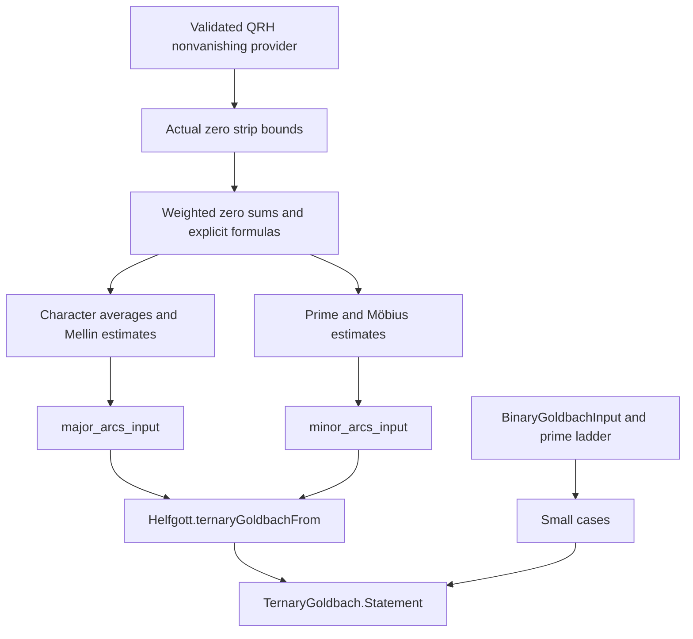

# QRH provider and integration blueprint

This blueprint records a research plan against the existing Goldbach statements. The QRH providers have been inspected at a pinned source revision. Their exported proof terms have not been checked in this environment. The proposed adapters and downstream replacements remain proof obligations.

Compilation stopped on the user's research-only instruction. At 2026-11-10 22:10:07 America/Los_Angeles, the owned build wrapper, launcher and Lean child were absent. Twenty-four validated prerequisite receipts survived, through `TernaryGoldbach.Explicit.ZetaDatum`. `ZetaExplicit` has no success receipt. Its interrupted staging output remains outside the validated artifact set.

## Fixed source and target

The target checkout is `work/ternary-goldbach`, base commit `23b2d68ca344203d4384e0aff7affa4ec034bef9`, branch `codex/qrh-replacement`. Its current additional source files are the previously checked `Explicit/QrhNumeric.lean` and `Explicit/QrhMellin.lean`. Both are untracked in the checkout. The existing final theorem and its other source files retain their original statements.

The full objective is the existing `TernaryGoldbach.Statement` with `BinaryGoldbachInput` as its only external mathematical premise. The large-case objective is the existing `TernaryGoldbachFrom (10 ^ 27)`. The latter uses the endpoint `10 ^ 27 ≤ n`. The former quantifies over odd natural numbers with `5 < n`. [Statement.lean, lines 12–40](https://github.com/calr3/ternary-goldbach/blob/23b2d68ca344203d4384e0aff7affa4ec034bef9/TernaryGoldbach/Statement.lean#L12)

The QRH checkout is `work/openai-math`, commit `4eaee87548250b2682affda7d05d947c05554bae`. Its working tree is clean. Its toolchain is Lean v4.34.1, with Mathlib `d13f23b723b8a846827a245b89c10fc7d3f11612`. Goldbach uses Lean v4.35.0 and Mathlib `56a005855ea17e0b0958f73ec801ae140b0a1679`. The source port therefore needs an explicit compatibility check. [QRH toolchain](https://github.com/openai/math/blob/4eaee87548250b2682affda7d05d947c05554bae/lean/lean-toolchain), [QRH manifest](https://github.com/openai/math/blob/4eaee87548250b2682affda7d05d947c05554bae/lean/lake-manifest.json)

## Exact provider interfaces

The public seven-eighths provider module is `OAI.NumberTheory.DirichletL.Nonvanishing`.

| Export | Exact mathematical inputs and conclusion |
| --- | --- |
| `OAI.DirichletCharacter.LFunction_ne_zero_of_seven_eighths_lt_re` | Implicit `q : ℕ`, instance `[NeZero q]`, `χ : DirichletCharacter ℂ q`, implicit `s : ℂ`, `(7 / 8 : ℝ) < s.re`, and `¬ (χ = 1 ∧ s = 1)`. Conclusion is `_root_.DirichletCharacter.LFunction χ s ≠ 0`. |
| `OAI.riemannZeta_ne_zero_of_seven_eighths_lt_re` | Implicit `s : ℂ` and `(7 / 8 : ℝ) < s.re`. Conclusion is `riemannZeta s ≠ 0`. The source export has no separate `s ≠ 1` premise. |

These exports cover every positive modulus and every character. Their types have no conductor limit, height limit, or primitive-character premise. Both delegate to `SevenEighths.ProbeFinalAssemblyUnconditional`. That module proves `detector_certified_bands` and supplies it to its Dirichlet and zeta assembly theorems. The absence of an exposed assumption in these types is a source observation, with transitive proof validation still pending. [Nonvanishing.lean, lines 19–31](https://github.com/openai/math/blob/4eaee87548250b2682affda7d05d947c05554bae/lean/OAI/NumberTheory/DirichletL/Nonvanishing.lean#L19), [FinalAssemblyUnconditional.lean](https://github.com/openai/math/blob/4eaee87548250b2682affda7d05d947c05554bae/lean/OAI/NumberTheory/DirichletL/Detector/FinalAssemblyUnconditional.lean)

A smaller provider is `OAI.NumberTheory.DirichletL.RowCompletion.ZeroFreeRegion`.

| Export | Exact mathematical inputs and conclusion |
| --- | --- |
| `OAI.ShortDraft.dirichlet_LFunction_ne_zero` | `q : ℕ`, `[NeZero q]`, `χ : DirichletCharacter ℂ q`, `s : ℂ`, `(23 / 24 : ℝ) < s.re`, and `¬ (χ = 1 ∧ s = 1)`. Conclusion is `DirichletCharacter.LFunction χ s ≠ 0`. |
| `OAI.ShortDraft.riemannZeta_ne_zero_of_re_gt` | `s : ℂ`, `(23 / 24 : ℝ) < s.re`, and `s ≠ 1`. Conclusion is `riemannZeta s ≠ 0`. |

The smaller provider applies `CanonicalRowCompletion.dirichletTarget_unconditional`. Its `ShortDraft.DirichletTarget` definition expands to the same quantified statement about the actual Mathlib L-function. The source supplies `exists_actual_fixedShellModels`, whose witness uses `actual_fixedShellModels` and the proved fiber identity `ActualFiber.completedT_eq_reflectedFiber_idealValue`. A later audit must follow these supplied terms through their imports. [RowCompletion/ZeroFreeRegion.lean, lines 188–214](https://github.com/openai/math/blob/4eaee87548250b2682affda7d05d947c05554bae/lean/OAI/NumberTheory/DirichletL/RowCompletion/ZeroFreeRegion.lean#L188), [EisensteinCoordinates.lean, line 253](https://github.com/openai/math/blob/4eaee87548250b2682affda7d05d947c05554bae/lean/OAI/NumberTheory/DirichletL/Arithmetic/EisensteinCoordinates.lean#L253)

## Actual dependency cost

| Provider | OAI source closure | Additional source closure | Total source modules |
| --- | --- | --- | --- |
| Seven-eighths public provider | 2924 modules, 486490 lines | 19 modules from PrimeNumberTheoremAnd and RellichKondrachov | 2943 |
| Twenty-three-twenty-fourths provider | 286 modules, 190290 lines | 15 RellichKondrachov modules | 301 |

The complete seven-eighths assembly already reaches `Foundation` transitively. `Foundation` alone reaches 287 modules, while `FinalAssemblyUnconditional` reaches 2923. Removing the explicit Foundation import from the public wrapper would leave that assembly dependency intact. The local records are `qrh-modules.json`, `qrh-import-graph.json`, and `../zero-sum/row-completion-closure.json`.

The external entry points are `PrimeNumberTheoremAnd.Wiener` and `RellichKondrachov.Analysis.FunctionalSpaces.Sobolev.Euclidean.Rellich`. Their source roots already exist under `work/qrh-dependencies`. PrimeNumberTheoremAnd is pinned to `c39a751132c88b6e8080b74c74023fd95b3d8be0`; RellichKondrachov is pinned to `70f85d4c1bf99c6e7d61e8be4daa6f3664d08d23`. The exact upstream Lean 4.34.1 patches have hashes `0890432340c0025973bcfe070b634355fa366cc831595f68526e4c73c8903d82` and `0c121d8517dfeadc93ef24fe2deb56beec7cb3998e2552dee8f61c780b1408c8`, respectively. `work/qrh-dependencies/patched-module-closure.json` records their paths and provenance.

A source scan found no `sorry`, `admit`, or `axiom` tokens in the seven-eighths OAI closure. A separate scan found no `sorryAx`, `native_decide`, `implemented_by`, `extern`, `unsafe`, `ofReduceBool`, `ofReduceNat`, or kernel-skip tokens in its DirichletL subtree. These scans leave imported proof terms and semantic fidelity to the validation stages below.

## Minimal integration route

Use a separate source port against the target v4.35.0 environment. Preserve the pinned original files and record each compatibility change as a diff. Preserve the theorem inputs, conclusions, carriers, and meaning-carrying definitions. An API or tactic repair must discharge the same obligation as the original proof.

The required source roots are OAI plus the one or two external packages in the selected closure. Mathlib and its support packages can use the existing read-only v4.35.0 artifacts. The native compiler is `C:/Users/glaze/.elan/toolchains/leanprover--lean4---v4.35.0/bin/lean.exe`; the package cache is `C:/Users/glaze/Documents/Codex/2026-11-02/lo/formalization/z-in-q/.lake/packages`. The compiler reports commit `eb6cafb7290e8bd5f2937522d8d804f58f02bafc` and executable SHA256 `ec7a472d1c12a09b0c0c718f7427c2be527b3f5f07810fdbe076c2507c7a91ea`.

Keep `autoImplicit=false` for OAI and the two prepared external packages. Use each source package's own root when calculating its Lean module name. Put the owned output directory and the Mathlib artifact directory first in the search path. Preserve the existing project layout and its legacy Lean files.

The full upstream OAI Lake configuration includes many unrelated packages and executable pre-resolution patch logic. A minimal isolated project or direct source driver should select the actual closure above. The prepared `work/qrh-build/build_qrh.py` computes these closures, but its cache publication still needs the reviewed generation protocol from `build_project.py` before persistent use. Its current implementation relies on dependency timestamps and publishes directly to final output paths. [OAI Lake configuration](https://github.com/openai/math/blob/4eaee87548250b2682affda7d05d947c05554bae/lean/lakefile.lean)

The reviewed project driver binds source hashes, exact dependency receipt hashes, artifact inventory hashes, compiler identity, options, and package paths. It stages a unique generation, checks successful exit and a complete artifact set, publishes with no concurrent readers, and writes the success receipt last. Its approved hash is `D70B96192B3CCCD9FB6E43095082CD35AFF8F0CE1F4F16915A730D9304F23704`. The first sixteen outputs were preserved through an explicit independently reviewed legacy inventory. Twenty-four success receipts now exist. These are reusable local infrastructure for later authorized compilation.

## Adapters required by the analytic proof

A thin provider adapter should prove an upper bound on the real part of an actual nontrivial zero. For a Dirichlet zero with `0 < ρ.re < 1`, the pole exclusion follows from `ρ ≠ 1`. Applying the seven-eighths provider by contradiction gives `ρ.re ≤ 7/8`. The corresponding smaller-provider adapter gives `ρ.re ≤ 23/24`. These adapters introduce no new analytic input.

For zeta, a two-sided strip can use the existing `Xi.xiF_one_sub` and `Xi.xiF_eq_zero_iff`. Reflection transfers a nontrivial zero at ρ to one at `1 − ρ`. Combining this with the upper bound gives `1/8 ≤ ρ.re ≤ 7/8`, or `1/24 ≤ ρ.re ≤ 23/24` for the smaller provider. For primitive Dirichlet characters, the available Mathlib entry point is `IsPrimitive.completedLFunction_one_sub`; the adapter must also prove the gamma-factor and root-number nonvanishing needed to transfer zeros between χ and χ⁻¹. Existing `LGrowthLeft` already uses that functional equation. [Xi.lean, lines 24–56](https://github.com/calr3/ternary-goldbach/blob/23b2d68ca344203d4384e0aff7affa4ec034bef9/TernaryGoldbach/Explicit/Xi.lean#L24), [LGrowthLeft.lean, lines 251–269](https://github.com/calr3/ternary-goldbach/blob/23b2d68ca344203d4384e0aff7affa4ec034bef9/TernaryGoldbach/Explicit/LGrowthLeft.lean#L251)

Keep the existing zero carriers and multiplicities. In particular, `zetaF` is the pole-removed function obtained from `(s−1)ζ(s)` with its specified value at one, while `zerosRectD` and `multRectD` provide the finite zero sums used by the explicit formula. The adapter must explicitly transfer its conclusion to these carriers, handle the distinguished zero at zero separately, and preserve multiplicity weights. [ZetaGrowth.lean, line 17](https://github.com/calr3/ternary-goldbach/blob/23b2d68ca344203d4384e0aff7affa4ec034bef9/TernaryGoldbach/Explicit/ZetaGrowth.lean#L17), [Datum.lean, lines 81–96](https://github.com/calr3/ternary-goldbach/blob/23b2d68ca344203d4384e0aff7affa4ec034bef9/TernaryGoldbach/Explicit/Datum.lean#L81)

## Validation sequence

1. Verify the pinned source and patch identities, compiler identity, package identities, and exact export names. Preserve all prior validated artifacts through their receipts.
2. Check a bounded original source leaf in the target environment, then the selected full provider closure. Record every compatibility repair and failed target. An isolated successful leaf establishes only that leaf.
3. Check the provider at its reconstructed full type, including implicit and instance binders. Expand `DirichletTarget`, project-owned predicates, and any supplied witness bundles. The source-level supplier of each required premise must appear in the proof term.
4. Inspect transitive axioms of every exported provider and adapter. The intended permitted set is `propext`, `Classical.choice`, and `Quot.sound`. Check theorem types separately because an unwanted `Fact PlattGRH` argument can survive a clean axiom report.
5. Run the existing seven-eighths comparator in its intended separate challenge and solution environments. Its challenge source contains a placeholder and duplicates the solution's fully qualified export. Keep that source in the comparator role. The configuration currently has `enable_nanoda=false`, so a report must explicitly identify which kernel or independent checker actually ran.
6. Independently audit the ported declaration against the pinned mathematical source, then check a consumer application that supplies each provider premise from the concrete zero hypotheses. Repeat this for the weighted explicit-formula consumer and final assembly.

The comparator permits the same three standard axioms and names the exact public Dirichlet export. A comparator configuration, source scan, or import graph alone supplies no completed validation result. [Comparator configuration](https://github.com/openai/math/blob/4eaee87548250b2682affda7d05d947c05554bae/lean/ComparatorChallenges/DirichletSevenEighths.json), [Challenge source](https://github.com/openai/math/blob/4eaee87548250b2682affda7d05d947c05554bae/lean/ComparatorChallenges/DirichletSevenEighths.lean)

## Compatibility with final Goldbach assembly

The current `PlattGRH` premise requires exact equality `ρ.re = 1/2` in specified conductor and height ranges. The QRH provider yields a closed upper strip bound. `zero_sum_boundG` consumes the equality twice in its low-zero contribution, through `x^ρ.re = √x` and through the restriction of the Mellin transform to the critical line. Its conclusion contains `√x * E1g`. A replacement therefore needs a proved strip or averaged zero-sum estimate, including new Mellin bounds and constants. [Statement.lean, lines 55–61](https://github.com/calr3/ternary-goldbach/blob/23b2d68ca344203d4384e0aff7affa4ec034bef9/TernaryGoldbach/Statement.lean#L55), [ZeroSumGen.lean, lines 200–269](https://github.com/calr3/ternary-goldbach/blob/23b2d68ca344203d4384e0aff7affa4ec034bef9/TernaryGoldbach/Explicit/ZeroSumGen.lean#L200)

The downstream proof has the following obligations.

The major-arc lower bound currently contributes `1.049 x²/κ`, and the minor-arc upper bound contributes `1.0376 x²/κ`, at `x = xOf N` for odd `N ≥ 10^27`. Their difference must still dominate the existing nonprime loss. Any revised estimates must prove the full numerical inequality at the original threshold, including all conductor sums and weighting constants. [Helfgott/Inputs.lean, lines 66–126](https://github.com/calr3/ternary-goldbach/blob/23b2d68ca344203d4384e0aff7affa4ec034bef9/TernaryGoldbach/Helfgott/Inputs.lean#L66), [Helfgott/Main.lean, lines 29–75](https://github.com/calr3/ternary-goldbach/blob/23b2d68ca344203d4384e0aff7affa4ec034bef9/TernaryGoldbach/Helfgott/Main.lean#L29)

The parent's proposed alternate budget uses a major-arc constant of `1.0404` with the current minor-arc constant of `1.0376`, leaving `0.0028 x²/κ`. To use that variant, the assembled count bound and final numerical comparison must both be proved with `0.0028`. The current `final_inequality_crude` proves the comparison with `0.0114`, so it does not by itself certify the smaller margin. These are proposed intermediate bounds; the current source has not changed.

There is numerical room for that variant in the existing nonprime estimate. Write `xOf N = N/c`, where the existing `xOf_denom_bounds` gives `c ≤ 2.02` and `κ = 49`. The normalized crude nonprime loss is bounded by

    6.7e6 * 49 * 4.0804 * log N / sqrt N.

This expression decreases for `N ≥ 10^27`. A floating-point consistency check at `10^27` gives `0.0026336197747554345`, below `0.0028` by about `0.00016638`. A certified endpoint estimate and the monotonicity proof remain required in Lean. The major-arc bound `1.0404` itself remains a separate analytic obligation. [Numerics.lean, lines 10–12 and 71–74](https://github.com/calr3/ternary-goldbach/blob/23b2d68ca344203d4384e0aff7affa4ec034bef9/TernaryGoldbach/Helfgott/Numerics.lean#L71), [Defs.lean, line 80](https://github.com/calr3/ternary-goldbach/blob/23b2d68ca344203d4384e0aff7affa4ec034bef9/TernaryGoldbach/Helfgott/Defs.lean#L80)

The parallel local fixed-gap research uses the existing zero-free region and a new low-height argument to target `ρ.re ≤ 249/250` below height `10^8`. It can support the far-asymptotic and adjacent-range psi work without loading OAI. Those drafts remain uncompiled. Their scope leaves the full finite-range and major-arc obligations open. This smaller local route is useful to the shared infrastructure plan, while the provider route above remains the route to a global seven-eighths strip.

Final acceptance requires the large-case export to have the existing `TernaryGoldbachFrom (10 ^ 27)` type with all analytic inputs supplied by proved terms. The full export must consume only `BinaryGoldbachInput` as its external premise. Audit both the instance-based exports and the explicit-hypothesis wrappers in `MainTheorems`. Preserve the original natural-number carriers and endpoint conventions. [Helfgott/Main.lean, lines 68–94](https://github.com/calr3/ternary-goldbach/blob/23b2d68ca344203d4384e0aff7affa4ec034bef9/TernaryGoldbach/Helfgott/Main.lean#L68), [MainTheorems.lean, lines 16–27](https://github.com/calr3/ternary-goldbach/blob/23b2d68ca344203d4384e0aff7affa4ec034bef9/TernaryGoldbach/MainTheorems.lean#L16)

## Research handoff

The immediate unresolved provider questions are v4.35 source compatibility, full transitive proof validation of either OAI export, and the numerical sufficiency of the downstream strip-based estimates at `10^27`. The smaller 301-module provider can test the integration architecture and support weaker-gap applications. The seven-eighths provider still requires its 2943-module closure and its own final export audit.

All future compilation is outside tonight's research-only instruction. The preserved local state consists of the pinned sources, dependency patches, reviewed project driver, twenty-four success receipts, interrupted staging data for `ZetaExplicit`, and the independent research drafts. The stopped process evidence is wrapper31692, launcher31644, child27560, with session9960 deliberately terminated and all three absent on the follow-up check.
