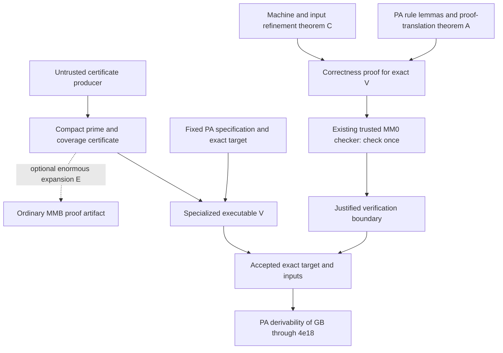

# A concrete acceptance contract for accelerated MM0 Goldbach checking

Research design, 2026-11-10 Pacific. No implementation or formal proof was produced for this note. Target: an efficient checker establishing PA derivability of binary Goldbach through 4e18, with upfront development permitted. This advances the architecture beyond explicit MMB byte-arithmetic traces; it does not claim that the required verified checker already exists.

## Recommendation

Build a small, specialized certificate checker with a proved contract for its **exact executable**. Its hot operation should initially be a verified array-of-u64 shift/OR coverage loop, together with certified prime data and a checked interval frontier. This follows the faster native coverage candidate already measured, rather than requiring general arbitrary-precision multiplication from the outset.

Check the executable's correctness proof once with the existing trusted MM0 checker. Run the specialized executable on the large compact certificate. That creates an alternative justified verification boundary. It can preserve PA derivability without emitting the expanded ordinary MMB Goldbach proof. If an ordinary MMB artifact is separately required, the expansion must also be generated and checked; it is a different deliverable with different costs.

## 1. Source pin and actual toolchain status

All repository citations below refer to commit `0d414c0bfdaaeb7fea571895127abc1fa5a3d956`.

The MM0 specification distinguishes the axiom/theorem specification from an implementation-dependent proof input. Its contract is derivability from the given axioms; it does not require every conforming checker to consume the current MMB representation. This permits a specialized accelerated proof format while retaining the same mathematical foundation. [Pinned MM0 specification, introduction](https://github.com/digama0/mm0/blob/0d414c0bfdaaeb7fea571895127abc1fa5a3d956/mm0.md#L5-L14).

The strongest immediately useful source contract is `Verifier_Valid`: an initial configuration for the specified verifier, followed by successful execution on the input, implies `Valid` for that input. `Valid` means that parsing/elaboration yields a valid environment with a proof, rather than asserting semantic truth of every PA theorem. [Verifier specification](https://github.com/digama0/mm0/blob/0d414c0bfdaaeb7fea571895127abc1fa5a3d956/examples/verifier.mm0#L7-L27), [definition of Valid](https://github.com/digama0/mm0/blob/0d414c0bfdaaeb7fea571895127abc1fa5a3d956/examples/mm0.mm0#L1248-L1258).

This is a specification to emulate, not an already completed verified binary. At the pin, `compiler.mm0` explicitly introduces `axiom sorry`; `verifier.mm1` imports that library, leaves core executable/termination declarations without proof bodies, defines the proposed representation relation as `True`, and contains unfinished code. The small derivation of `Verifier_Valid` depends on the preceding uncompleted termination specification. [Compiler dependency](https://github.com/digama0/mm0/blob/0d414c0bfdaaeb7fea571895127abc1fa5a3d956/examples/compiler.mm0#L1-L13), [verifier work in progress](https://github.com/digama0/mm0/blob/0d414c0bfdaaeb7fea571895127abc1fa5a3d956/examples/verifier.mm1#L1-L37), [unfinished branch](https://github.com/digama0/mm0/blob/0d414c0bfdaaeb7fea571895127abc1fa5a3d956/examples/verifier.mm1#L179-L199).

MMC offers imperative code, separation-style assertions, and generation of MM0 proofs, but that interface alone does not close the incomplete dependencies. The exact fragment used must be audited and its generated proof checked without `sorry`. [Pinned MMC design](https://github.com/digama0/mm0/blob/0d414c0bfdaaeb7fea571895127abc1fa5a3d956/mm0-rs/mmc.md#L1-L23).

Useful reusable foundations include PA with induction and conservative predicate/set notation, plus definitions of bitwise operations, fixed-width numbers, bytes, machine instructions, and ELF initialization. These are source ingredients requiring dependency review, not a claim that the future bulk checker has already been proved. [PA core](https://github.com/digama0/mm0/blob/0d414c0bfdaaeb7fea571895127abc1fa5a3d956/examples/peano.mm0#L103-L170), [bitvector/byte definitions](https://github.com/digama0/mm0/blob/0d414c0bfdaaeb7fea571895127abc1fa5a3d956/examples/x86.mm0#L1-L90).

For a claim of exact PA derivability, also account for the hexadecimal/string interface: `peano_hex.mm0` introduces explicit coercion axioms such as `h2nlt`, `c2nlt`, and `s2nstr`. They are intended as a syntactic interface, but importing them is not literally the same as an unchanged PA axiom list. Either give the conservative translation into naturals/finite lists, including these interface rules, or use a nat/list encoding directly. Do not silently count the entire imported interface as already discharged. [Pinned coercion interface](https://github.com/digama0/mm0/blob/0d414c0bfdaaeb7fea571895127abc1fa5a3d956/examples/peano_hex.mm0#L67-L134).

## 2. Freeze what acceptance is supposed to establish

Let Gamma be the exact approved first-order PA presentation and its conservative definitions. Freeze the meanings of natural numbers, primality, evenness, and the numerical constant N=4e18. The target is

    GB(N) := forall n, 4<=n<=N and Even(n)
                       implies exists p q, Prime(p) and Prime(q) and n=p+q.

Let `Prf_Gamma(d, phi)` be an explicit syntactic predicate saying that d is an ordinary derivation of the formula coded by phi. It does not mean that a generator printed “success.” A proposed checker must not be allowed to substitute a different definition of Prime, a smaller N, or new assumed coverage facts.

The following are proposed mathematical interfaces, not declarations already implemented in MM0:

    Check(spec, compactCertificate) = accept
      -> exists d, Prf_Gamma(d, targetAST(spec)).                 (A)

    ExactSpec(spec)
      -> targetAST(spec) = code(GB(4e18))
         and axioms(spec) = approvedGamma.                      (B)

For a fixed-purpose binary, `ExactSpec` can simply require a canonical fixed header/AST. If a flexible parser is retained, its elaboration, definitions, axiom whitelist, and exact final theorem must be checked. A file hash is a useful transport identifier; mathematical identity is equality of the bound bytes/AST and definitions, not a collision-resistance axiom secretly replacing that equality.

A more constructive version of (A) defines a proof translator E and proves

    Check(spec,c)=accept -> Prf_Gamma(E(spec,c),targetAST(spec)). (A')

E may expand to an enormous derivation. It need not be run or materialized for the accelerated checker to be justified. Its termination and proof-preservation argument must actually be supplied, however. Merely writing down the symbol E is not an admissibility proof.

## 3. Why this does not require PA to prove its own soundness

The obligation is syntactic proof preservation: each added arithmetic or bulk operation can be replaced by a derivation from Gamma. It is not the reflection principle

    forall phi, (exists d, Prf_Gamma(d,phi)) -> True(phi).

No general truth predicate or global PA soundness assumption belongs in the checker contract. Local arithmetic theorems, finite computation encodings, and induction over the certificate's steps can establish (A)/(A') without that reflection principle. The exact formalization and totality proof remain work items.

This distinction also prevents a subtle overclaim. An internal theorem asserting that some PA proof exists is not automatically an internal PA proof of its conclusion. For the accelerated artifact, the acceptance claim is that a correctly justified verifier establishes **PA derivability at the verification boundary**. A consumer insisting on the ordinary proof artifact must request E's expanded output or another ordinary derivation. The difference concerns representation and verification implementation, not additional mathematical axioms.

## 4. Local rules with concrete proof obligations

Use a registry of immutable, interpreted objects. Its logical invariant is that each exported fact has a Gamma derivation. Do not use a mutable untyped pointer table whose entries become trusted because a producer supplied them.

| Compact operation | Checks performed | Mathematical fact exported |
|---|---|---|
| `PRIME_CERT(p,c)` | Deterministic Lucas/Pratt or selected Pocklington certificate, all required factor proofs and modular equalities | `Prime(p)` |
| `PRIME_TABLE(base,len,data,c)` | Certified construction or checking of every positive flag; range, parity and array interpretation | Every set bit denotes the corresponding prime |
| `ANCHORS(origin,offsets,refs)` | References to proved prime facts; exact equations connecting anchors, origin and offsets | Selected offsets have prime anchors |
| `COVER(origin,width,table,anchors)` | Bounds, source windows, exact shifts/unions, active-word mask and full coverage | Every target even in this interval is a sum of two primes |
| `ADVANCE(frontier,interval)` | Interval starts exactly at frontier and ends within the frozen target range | Covered prefix extends to the new frontier |
| `FINISH` | Frontier reaches the exact endpoint; initial exceptions included; no missing required input | `GB(4e18)` |

For `COVER`, prove the scalar bitset lemma once: if source bit j implies primality of its interpreted integer, each selected anchor is prime, and the OR of its shifted source masks contains every active target bit, each target has a prime decomposition. The checker evaluates that OR efficiently rather than emitting a separate proof for every bit.

`PRIME_TABLE` must establish soundness of positive flags. Proving only that cleared bits are composite is insufficient. A verified sieve route needs a complete list or generation of necessary small prime divisors, correct strike ranges, removal of 1, and proof that a surviving composite would have been struck. Extra zero flags are harmless. Alternatively certify only the positive primes by deterministic certificates, if cheaper.

The registry invariant plus local rule admissibility gives an induction proving (A). A proof translator can instantiate the generic PA theorems and the ordinary finite arithmetic derivations for the concrete operations. It is allowed to be far less efficient than the accelerated checker; it is not allowed to rely on unproved table/cover axioms.

### Bounded-memory assembly

Start with a proved small initial prefix including 4, then read blocks in increasing order. After each fully checked block, retain only its new covered frontier and the required shared prime data. The invariant says that the prefix theorem is derivable; it need not retain every local proof body. This avoids millions or trillions of resident theorem declarations.

Parallel workers may check local blocks, but a message saying “worker succeeded” is not a mathematical input. Either the final verification boundary includes the authenticated, justified worker/checker system and its exact inputs, or a final checker consumes/verifies their compact certificates itself. Reverification can be parallel and still bounded-memory. Hash-linked manifests alone do not establish the interval theorems.

## 5. Connect abstract acceptance to the actual executable

Let V be the exact final executable bytes. Define initial configurations and successful execution using a stated instruction, memory, loader, and input model. Prove

    Initial(V, specBytes, certBytes, state0)
      and RunToAccept(V,state0,state1)
      -> Check(decodeSpec(specBytes),certBytes)=accept.          (C)

Combined with (A) and (B), this says successful execution on the bound inputs implies a Gamma derivation of the desired target. The proof must apply to malformed inputs too: they may reject, exhaust resources, or fail to terminate if the chosen contract allows that, but may not accept falsely. Total termination is desirable operationally; acceptance soundness only needs the stated partial-correctness implication.

The pinned x86 model already exposes a concrete `initialConfig` based on ELF contents and memory mapping, including nontrivial loader behavior. Reusing it requires matching its assumptions to the deployment, not assuming all operating systems initialize memory identically. [Pinned ELF/initial configuration definitions](https://github.com/digama0/mm0/blob/0d414c0bfdaaeb7fea571895127abc1fa5a3d956/examples/x86.mm0#L1500-L1569).

The theorem (C), its arithmetic dependencies, and the binary it mentions must be bound together. Checking a correctness proof about one source program while running a differently optimized binary leaves a gap.

## 6. What must be proved about the hot implementation

For the first u64 implementation, use an explicit representation map from owned arrays to finite bitsets and natural numbers. Its refinement proof needs:

* correct little-/big-endian interpretation and final partial-word masks;
* correct cross-word shifts, including shift zero and shifts by the full word width;
* no out-of-bounds or uninitialized reads, and correct halo/source endpoints;
* justified overflow behavior for indices and intermediate arithmetic;
* immutable certified source/anchor data, or a proved update protocol preserving their meaning;
* a loop invariant linking the current accumulator and covered frontier to the source/anchor semantics;
* rejection on inconsistent lengths, unsupported versions, missing dependencies or failed arithmetic tests.

For primality, 64-bit input size does not make products fit in 64 bits. Modular multiplication/exponentiation must have a proved wide-product or overflow-safe reduction implementation. A proved abstract Pocklington theorem does not verify a native modular-arithmetic routine automatically.

SIMD is optional. First prove a scalar machine loop with a reliable cost baseline. Then prove a refinement for the vector instructions actually used, or translation-validate the vectorized binary. Adding a general GMP/FLINT call without proving its implementation leaves that library inside the trusted code base. It may be a deliberately chosen interim configuration, but it is not the fully verified small-kernel route proposed here.

## 7. Practical route without waiting for the whole MMC project

1. Freeze Gamma, `GB(4e18)`, certificate decoding, and representation maps. Write the simple reference checker and the admissibility interfaces. Audit their meanings before optimizing.
2. Prove the PA cover/primality/interval lemmas and the finite-state checker invariant. Include enough computation encoding to establish the ordinary-derivation translation, not just semantic plausibility.
3. Implement the restricted u64 checker and measure complete input decoding, prime verification, coverage and assembly on real blocks. Keep the producer untrusted. Its search, packing and factorization need not be proved.
4. Prove the **specific resulting executable** refines the reference checker. A proof-producing compiler or per-binary translation validation can supply this; universal correctness of an entire compiler is not required if the emitted per-program proof is checked. Any incomplete MMC lemmas used by that proof still have to be completed or replaced. A small hand-verified instruction subset is another possible path.
5. Have the existing MM0 verifier check the complete correctness certificate with only the approved dependencies. Audit the exact axiom closure and binary binding. Only then promote the fast checker to the accepted verification boundary.
6. Run the compact certificate through that checker, recording the exact target, binary and input identities and the success conditions. Retain a reproducible compact artifact. An optional ordinary-MMB expansion is a separate archival/interoperability project.

Development of steps 2 and 4 is substantial, not an accounting trick that makes verification free. But it is upfront work amortized over the huge finite computation. It directly addresses why ordinary per-byte proof expansion is not a lower bound on efficient PA verification.

## 8. Remaining trust and delivery distinctions

The initial MM0 kernel used to check V's correctness proof remains a trusted bootstrap unless its own verified chain is independently completed. At runtime one also assumes that hardware implements the chosen instruction semantics, the loader and input channel match the model, and the exact checked bytes are executed. Faulty hardware or an unmodeled host modifying supposedly immutable mappings can invalidate that correspondence. Use owned snapshots or include the required immutability/input assumptions; a pre-run hash does not prevent later mutation.

These are implementation trust assumptions, not Goldbach or primality axioms. They must nevertheless be stated. The goal is a small, reviewable and possibly machine-proved correspondence to the mathematical checker, not a claim to remove every physical assumption.

Three deliverables should remain distinct:

* **Ordinary MMB Goldbach proof:** usable by the current stock checker; potentially enormous expansion/checking cost.
* **PA-preserving accelerated certificate:** compact input accepted by the justified specialized checker, with theorem (A)/(C) binding acceptance to ordinary PA derivability; no expanded MMB artifact promised.
* **Unverified fast computation:** useful for discovering certificates and benchmarking, but not accepted as the requested formal result.

The second is a rigorous and practical research target under the user's willingness to build tooling. Current evidence supports the architecture and its mathematical contracts; it does not supply the required PA admissibility proofs, completed executable-refinement proof, or a certified full-range run.

## 9. Larger anchor blocks with source-segment-major streaming

This is a sound additional scheduling architecture. It is a tuning option, not a claim that the largest block minimizes CPU time. It can avoid both an enormous resident small-prime table and hundreds of millions of outer-block records.

### Exact partition and source halo

Write N=4e18 and E=N/2. Choose an integer anchor-block size L>=3, measured in **even targets**, and an offset bound D>=0. Independently certify the initial interval

    4 <= n < 2L,       equivalently n <= 2L−2.

For each outer block r=1,...,floor(E/L), set

    w_r = min(L, E−rL+1),
    n_(r,t) = 2(rL+t),          0<=t<w_r.

These blocks are disjoint and cover exactly the remaining even targets through N, including N when E is a multiple of L. In that divisible case the last block has width one, not zero; dropping it would omit the endpoint.

Choose certified odd prime anchors

    q_(r,i) = 2rL − (2s_(r,i)+1),       0<=s_(r,i)<=D,

and require q_(r,i)>=3. Then

    n_(r,t) − q_(r,i) = 2(t+s_(r,i))+1.

Thus all outer blocks use the same source sequence P_j for the primality of 2j+1. The required indices satisfy 0<=j<L+D, so the global source limit is

    2L+2D−1,

not strictly 2L. Mark P_0=0, since 1 is not prime. These arithmetic equations and bounds belong in the cover-rule proof. An anchor outside the declared offset bound is rejected by this route; it needs a larger declared halo or a separately certified fallback.

For a target segment [a,b) with 0<=a<b<=L, retain source indices

    a <= j < b+D.

This includes every required t+s for a<=t<b, including t=b−1 and s=D. The global bound L+D remains valid for the last segment. Process only t<min(b,w_r) in a partial outer block. Missing or empty portions are skipped by the proved length condition, not reported as covered targets.

### Stream the source once

Generate and certify the first source segment plus its D-index halo. Process that same segment against all applicable outer blocks. Then retain the overlap, sieve the next new source region, and repeat. With target-segment capacity B, resident source data are O(B+D) bits rather than O(L) bits. A naive implementation that re-sieves each overlapping halo would add work; rolling retention avoids that repetition.

The segmented sieve needs the base primes through floor(sqrt(2L+2D−1)), together with its ordinary sieve state. Those base primes and the sieve transition invariants must be certified. They are vastly smaller than the whole source range, but not free.

The resulting order is source-segment-major, then outer block. Coverage for a particular numerical outer block is therefore interleaved with work on other blocks. A single numerical covered-prefix invariant from section 4 is insufficient for this schedule unless more state is recorded.

Two sound alternatives are:

1. A frontier f_r for each outer block, advanced only after its next target segment succeeds.
2. A strict two-dimensional lexicographic schedule, with counters for the current source segment and current outer block. Its invariant states that all blocks are covered through the previous segment boundary, and all earlier blocks in the current segment are covered through its new boundary. This uses a nested induction and does not require a separate stored frontier for every block.

The second is preferable for a sequential verifier with predictable scheduling. At completion it proves coverage of the entire rectangle intersected with t<w_r. Combined with the separately proved initial interval, it yields exactly GB(N). A parallel scheduler requires an equally explicit completion protocol; it must not replace this invariant with unverified worker status.

### Recursing on the initial interval

The first interval can be handled by the same architecture with a smaller block parameter, until reaching a manageable fully checked base case. The recursive target is N_next=2L−2, strictly below N when L<=E. No circular Goldbach assumption is introduced: source primality comes from the sieve or prime certificates, independently of the recursive binary-Goldbach proof. Each recursion level joins its initial interval to its outer blocks using the exact endpoint equations above.

### State and scale examples

Ignoring a small halo's effect on the square root, the following counts are exact for outer blocks and 512 anchors per block; source limits are approximate powers of two. The first recursive interval is additional.

| L | Outer blocks floor(E/L) | Outer anchors | 4-byte offsets only | Base-prime limit, approximately |
|---|---:|---:|---:|---:|
| 2^40 | 1,818,989 | 931,322,368 | 3.73 GB | 1.48 million |
| 2^45 | 56,843 | 29,103,616 | 116 MB | 8.39 million |
| 2^50 | 1,776 | 909,312 | 3.64 MB | 47.45 million |

Four-byte offsets require D<2^32; this storage excludes primality certificates, proof metadata, and other registry structures. If anchor values are also cached as eight-byte integers, add twice the offset-only storage. A four-byte frontier per block additionally requires L<=2^32; for these larger L use eight-byte frontiers, or the two-counter schedule instead. The table does not assume every candidate anchor pool succeeds.

At L=2^50, keeping all outer anchors and current source segment is modest. At smaller L, retaining every anchor can itself become expensive. One can batch outer blocks, but loading or rechecking their anchor proofs for every source segment can erase the intended amortization. The selected layout must account for that traffic and preserve the certified-data invariant.

### Optimize time and memory separately

A useful first objective is

    T(L) approximately C_sieve(L)*L
      + E*c_cover(log L, pool size, segment size, actual masks)
      + (E/L)*A*c_anchor
      + T_metadata_and_IO(L).

Here c_anchor includes whichever production and formal-checking costs the chosen accelerated implementation actually incurs. Do not insert the 55 ms Lean replay baseline into an accelerated-native design by default. Conversely, native anchor production alone is not certified anchor checking. Both costs must be identified.

Increasing L reduces anchor count and outer-block metadata, but enlarges the source sieve and lowers the density of its primes. The elementary heuristic 2/log(2L) falls from about 0.087 at L=2^32 to about 0.057 at L=2^50; actual conditional cover rates depend on arithmetic correlations and must be sampled. Larger pools or longer cover lists can therefore increase the dominant E*c_cover term.

For illustration only, an anchor-production rate of 0.2 ms would price the old 238.4-billion-anchor layout at about 1.5 core-years. If that rate applies and coverage takes tens or hundreds of core-years, saving anchor production by making L huge may be less valuable than preserving denser source primes. A costly formal anchor checker, source-table storage constraint, or metadata bottleneck could favor a different L. The correct result is a measured tuning frontier, not a fixed recommendation of L=2^50.

The next informative experiment sweeps L and segment size while measuring real cover costs, actual anchor-certificate checking, sieve time, source reuse, and peak resident state. Successful samples affect the cost model only; the eventual verifier must check every target or its explicit exceptional certificate.
